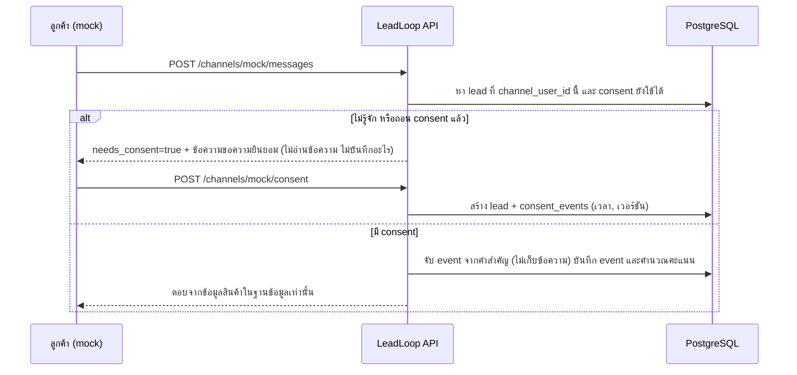

# Chat channels API (mock channel)

ช่องทางแชตรับข้อความลูกค้าเข้าระบบ ตอนนี้มีช่องทางจำลอง (`mock`) ส่วน LINE จะใช้แกนเดียวกัน (`handleIncoming` / `grantConsent` ใน `backend/channels.go`)



ทั้งสอง endpoint ต้องล็อกอินด้วย role `marketing` หรือ `admin`

## POST /channels/mock/messages

```json
{"external_id": "cust-001", "text": "ราคาเท่าไหร่"}
```

ตอบกลับ (มี consent): `lead_id`, `reply`, `detected` (event ที่จับได้), `score`, `level`, `qualified`, `immediate_handoff`
ตอบกลับ (ยังไม่มี consent): `needs_consent: true`, `reply` (ข้อความขอความยินยอม), `consent_version`
ถ้าไม่พบคำสำคัญเลย ระบบไม่คำนวณคะแนนใหม่ และตอบข้อความทั่วไป
`external_id` ไม่เกิน 100 ตัวอักษร, `text` ไม่เกิน 2,000 ตัวอักษร (เกิน = 400)

## POST /channels/mock/consent

```json
{"external_id": "cust-001", "display_name": "ลูกค้าทดสอบ", "campaign_id": 1, "consent_marketing": false, "consent_version": "v1"}
```

- ครั้งแรก: สร้างลีด (`created: true`) พร้อมหลักฐาน consent (เวลา + เวอร์ชัน)
- เรียกซ้ำสำหรับคนเดิม: ไม่สร้างลีดใหม่ (`created: false`); ถ้า consent เคยถูกถอน จะให้ใหม่; ถ้าเปลี่ยนแค่ `consent_marketing` จะบันทึกการเปลี่ยนนั้น
- `consent_version` ไม่ส่งมาจะใช้ค่า `CONSENT_VERSION` (ค่าเริ่มต้น `v1`); `campaign_id` ไม่พบ = 404
- คนที่ถูก anonymize แล้วกลับมาใหม่ จะถือเป็นคนใหม่ ต้องให้ consent ใหม่ และได้ลีดใหม่

## ตัวแปรใน .env (ไม่บังคับ)

| ตัวแปร | ใช้ทำอะไร |
|---|---|
| `CONSENT_VERSION` | เวอร์ชันข้อความขอความยินยอมที่แสดง (ค่าเริ่มต้น `v1`) ต้องขึ้นเวอร์ชันใหม่ทุกครั้งที่แก้ข้อความ |
| `PRIVACY_POLICY_URL` | ลิงก์นโยบายความเป็นส่วนตัวที่ใส่ท้ายข้อความขอความยินยอม |
| `PDPA_RETENTION_TEXT` | ข้อความระยะเวลาเก็บข้อมูล (ยังไม่มีค่าที่บริษัทกำหนด ถ้าไม่ตั้งจะไม่แสดง) |

## กติกาของการตอบ

- ตอบจากชื่อ ราคา และคำอธิบายสินค้าของแคมเปญที่ผูกกับลีดเท่านั้น
- ผ่อนชำระ การจัดส่ง ต่อรองราคา: ไม่มีข้อมูลในฐานข้อมูล จึงตอบว่าให้ทีมงานตอบโดยตรง ไม่แต่งข้อมูลเอง
- ขอคุยกับเจ้าหน้าที่ / ให้ติดต่อกลับ / ขอนัดดู: ตอบว่าส่งเรื่องให้ทีมงาน และลีดเป็น Hot ตามกฎเดิม
- คำว่า "หยุด" (unsubscribed): ถอน consent การตลาด และตอบรับทราบ
- ข้อความลูกค้าไม่ถูกเก็บ ไม่ถูกใส่ใน audit log

## ข้อจำกัด

- การแจ้งทีมขายเมื่อลีดเป็น qualified ยังไม่ได้ทำ ข้อความ "ส่งเรื่องให้ทีมงาน" จึงต้องมีคนดู `GET /leads?status=qualified` ไปก่อน
- ข้อความขอความยินยอมเป็นข้อความตัวอย่างของทีม ต้องให้บริษัทตรวจก่อนใช้จริง
- ยังไม่มี AI ตอบลูกค้า ใช้เทมเพลตจากข้อมูลสินค้า
- คำสำคัญ `gave_budget` (ระบุงบ) ยังไม่มีใน `event_keywords` และระบบยังไม่ดึงตัวเลขงบจากข้อความ กฎ "ระบุงบ" และ "งบพอกับราคา" จึงยังไม่ทำงานผ่านแชต
- LINE webhook ต้องลงทะเบียนก่อน `registerAuthRoutes` หรือยกเว้น JWT เพราะ LINE ไม่ส่ง token (ใช้ตรวจ `X-Line-Signature` แทน)
