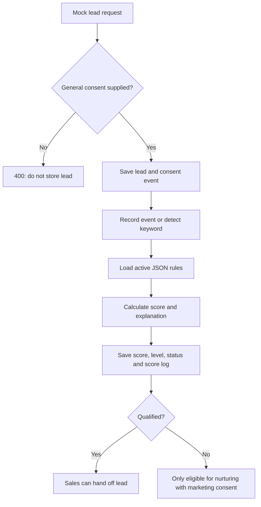

# LeadLoop Leads & Scoring API

> Development only: use fictitious/mock data. Do not send real customer data or production API keys during testing.

## Setup

1. Start services: `docker compose up --build -d`.
2. For an existing database, apply the migration: `docker compose cp db\leads.sql db:/tmp/leads.sql` then `docker compose exec db psql -U leadloop -d leadloop -v ON_ERROR_STOP=1 -f /tmp/leads.sql` (replace credentials/database if changed in `.env`). Do not pipe the file through PowerShell (`Get-Content ... | psql`): it can turn Thai text into `?`.
3. A new database volume runs the lead schema through `db/init.sql`.
4. Log in via `POST /auth/login`; send `Authorization: Bearer <token>` for protected endpoints. `/health` and `/auth/login` are public.
5. Import `postman/LeadLoop-Leads.postman_collection.json`.

## Lead endpoints

| Method | Path | Access | Purpose |
|---|---|---|---|
| POST | `/leads` | marketing/admin | Create lead; requires `consent_general=true` and non-empty `consent_version` |
| GET | `/leads?status=&level=&channel=` | authenticated | List up to 200 non-anonymized leads |
| GET | `/leads/:id` | authenticated | Lead details and score breakdown |
| POST | `/leads/:id/events` | marketing/admin | Record a structured event and recalculate score |
| POST | `/leads/:id/message` | marketing/admin | Detect event keywords; submitted raw text is not stored |
| POST | `/leads/:id/consent` | marketing/admin | Grant/withdraw `general` or `marketing` consent |
| POST | `/leads/:id/status` | sales/admin | Hand off a qualified lead, or close/lose a qualified/handed-off lead |
| GET | `/leads/:id/export` | admin | Export lead data, events and consent history |
| DELETE | `/leads/:id` | admin | Anonymize lead; legacy name/contact fields are also cleared |

Create lead example:

```json
{
  "display_name": "ลูกค้าทดสอบ 001",
  "channel": "mock",
  "channel_user_id": "mock-user-001",
  "budget": 12900,
  "consent_general": true,
  "consent_marketing": false,
  "consent_version": "mock-v1"
}
```

Allowed channels: `line`, `mock`, `web`. Unknown budget should be omitted or `null`, never use `0` to mean unknown.

## Scoring rules

| Method | Path | Access | Purpose |
|---|---|---|---|
| GET | `/scoring-rules` | authenticated | List rules |
| POST | `/scoring-rules` | marketing/admin | Create rule |
| PATCH | `/scoring-rules/:id` | marketing/admin | Edit rule |
| DELETE | `/scoring-rules/:id` | marketing/admin | Delete supplementary rule; if used, soft-deactivate |
| POST | `/scoring-rules/test` | marketing/admin | Dry-run rules against mock events without saving |
| POST | `/scoring-rules/recalculate` | admin | Recalculate existing leads after rule changes |
| GET | `/scoring-settings` | authenticated | Read thresholds and follow-up settings |
| PATCH | `/scoring-settings` | admin | Update settings |
| GET | `/event-keywords` | authenticated | Read event keywords |
| PUT | `/event-keywords` | marketing/admin | Replace complete keyword map |

Rule conditions use an allowlisted JSON evaluator and never execute code. Supported forms: `event` (optionally `where`), `lead`, `all`, `any`, and `not`; operators: `=`, `!=`, `>`, `>=`, `<`, `<=`, `in`, `contains`. Nesting is limited to five levels. The four core rules are protected from deletion/deactivation; supplementary rules can be disabled.

Example rule:

```json
{
  "name": "Mock: asks for color",
  "category": "intent",
  "condition": {"event": "asked_color"},
  "points": 5,
  "mode": "once",
  "active": true
}
```

## Scoring behavior

- Core rules: asks for details `+10`, asks to speak to a human `+30` and immediate qualification, asks price `+10`, callback request `+30` and immediate qualification.
- Supplementary rules and thresholds are seeded by `db/leads.sql`; draft defaults should be confirmed with the mentor.
- Score is clamped to configured min/max (default 0–100). Warm starts at 25, qualified/hot at 50, and some intent events qualify immediately.
- `unsubscribed` disqualifies the lead and stops marketing consent.
- Events store event type and structured metadata only, not raw customer messages.
- Rule changes do not automatically recalculate historical leads. Admin should call `POST /scoring-rules/recalculate` after review.

## Flow



## Verification notes

The pure scoring engine tests can run without external dependencies:

```powershell
cd backend
go test scoring.go scoring_test.go
```

Full integration verification requires Go module dependencies and a running PostgreSQL/Redis stack. Do not mark the API integration-tested until `go test ./...`, `docker compose up --build`, and the Postman flow pass against the local development database.
